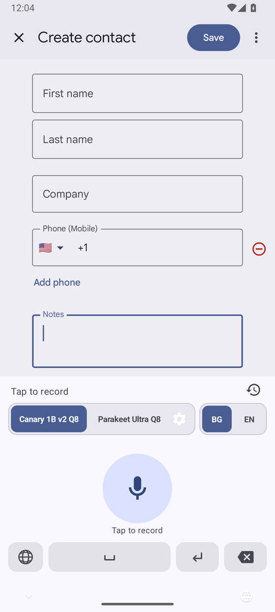
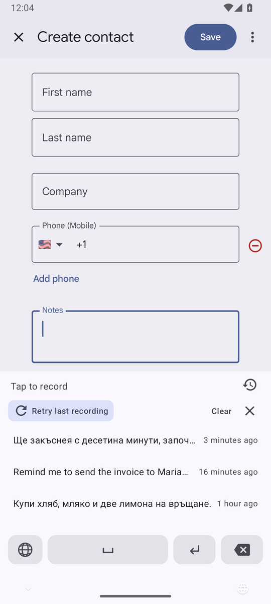
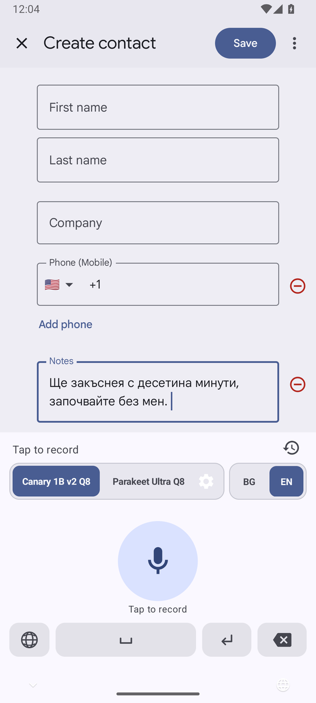
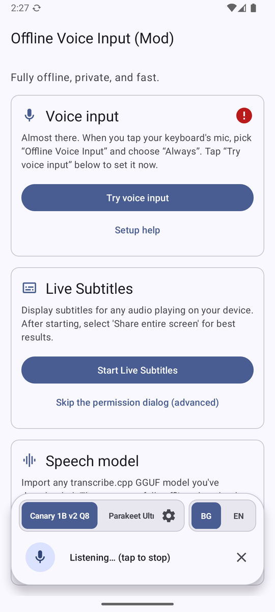

<div align="center">

# Offline Voice Input — Mod

**Private, on-device speech-to-text for Android, with one-tap model & language switching, transcript history and a keyboard that never gets stuck.**

A community fork of [notune/android_transcribe_app](https://github.com/notune/android_transcribe_app).
Everything runs on your phone. No account, no cloud, no internet permission.

[](https://github.com/ybabulkov/android_transcribe_app/releases/latest)
[](LICENSE)
[](https://github.com/notune/android_transcribe_app)

[](https://apps.obtainium.imranr.dev/redirect?r=obtainium://app/%7B%22id%22%3A%22dev.notune.transcribe.mod%22%2C%22url%22%3A%22https%3A%2F%2Fgithub.com%2Fybabulkov%2Fandroid_transcribe_app%22%2C%22author%22%3A%22ybabulkov%22%2C%22name%22%3A%22Offline%20Voice%20Input%20(Mod)%22%2C%22additionalSettings%22%3A%22%7B%5C%22apkFilterRegEx%5C%22%3A%5C%22no_model%5C%22%2C%5C%22invertAPKFilter%5C%22%3Atrue%7D%22%7D)

<table>
  <tr>
    <td align="center"><br><sub><b>One-tap model & language chips</b></sub></td>
    <td align="center"><br><sub><b>Transcript history & retry</b></sub></td>
    <td align="center"><br><sub><b>Tap to reinsert · switched to EN</b></sub></td>
  </tr>
</table>

<details>
<summary>More screenshots (home, voice popup with chips, live subtitles)</summary>
<p>
  
  
  
</p>
</details>

</div>

---

## ✨ What this fork adds

> [!TIP]
> The mod installs **next to** the official app (its own package, `dev.notune.transcribe.mod`, shown as *Offline Voice Input (Mod)*). You can try it without uninstalling anything.

### 1. One-tap model & language chips

Switch speech model or language right on the voice keyboard and the voice popup. You don't have to open settings or leave the app you're typing in.

- **Model chips** for every installed model, plus a ⚙ button to manage or import more.
- **BG / EN chips** for Bulgarian and English.
- **Language switches are instant.** Only the language changes inside the loaded model (in-place language update), so the ~1 GB model doesn't reload from storage.
- **Safe while you're talking:**

  | While recording… | What happens |
  |---|---|
  | **Tap** a chip | The recording is discarded and the switch happens right away |
  | **Long-press** a chip | What you said is transcribed first, then the switch is applied (the chip shows ⏱ and the hint says *Next: …*) |
  | *Auto-record* is on | After a tap-switch the keyboard starts listening again straight away |

  The keyboard-switch key works the same way: tap to leave now, long-press to transcribe first and then leave.
- **Canary needs a language.** Canary models can't auto-detect a language. If one is selected with the language set to *auto*, the mod applies your last explicit choice (Bulgarian by default).

### 2. Transcript history & retry

Your words don't get lost anymore.

- A 🕘 **history button** on the voice keyboard shows your **last 5 transcripts**. Tap one to insert it at the cursor.
- Each transcript is saved **before** it's typed into the text field. If inserting fails (the app lost focus, the field changed), the text is still in the history.
- **Retry last recording** runs the last recording through transcription again, using the model and language selected *now*. Useful when a model got your words wrong or a transcription failed.
- **Clear** (tap twice) wipes the history and the saved recording.
- Both stay in private app storage and are **excluded from cloud backup and device transfer**.

### 3. No more "Processing…" forever

Several bugs that could leave the keyboard stuck are fixed:

- Any error now ends the transcription properly. Before, some errors left the keyboard "busy": mic taps were ignored and queued switches never applied.
- A crash inside the transcription worker or during model loading now shows an error instead of hanging silently.
- Escape hatch: tapping the mic while it says *Processing* with nothing actually running resets the keyboard.
- *Transcribe, then switch keyboard* (long-press) waits for the text. It no longer leaves early when the "using built-in model" notice appears.

### 4. Canary 1B v2 as the built-in model

The bundled model is **NVIDIA Canary 1B v2 (Q8)** instead of Parakeet TDT 0.6B. It's bigger (~1.1 GB vs ~485 MB) and covers the same 25 European languages. You pick the language explicitly with the chips. Prefer a smaller download? Grab the `_no_model` APK and import any model you like.

### Upstream vs. this mod

| | Upstream | **Mod** |
|---|:---:|:---:|
| Offline voice input, voice keyboard, live subtitles | ✅ | ✅ |
| Switch model / language from the keyboard | — | ✅ one tap |
| Change language without reloading the model | — | ✅ |
| Transcript history (last 5) | — | ✅ |
| Retry the last recording | — | ✅ |
| Stuck-on-Processing fixes | — | ✅ |
| Built-in model | Parakeet TDT 0.6B v3 | Canary 1B v2 |
| Installs alongside the official app | — | ✅ |
| Google Play / F-Droid | ✅ | — (GitHub & Obtainium only) |

---

## 📥 Install

1. Download from the [latest release](https://github.com/ybabulkov/android_transcribe_app/releases/latest):
   - `offline_voice_input_mod_vX.apk`: includes Canary 1B v2 and works out of the box (~1.1 GB).
   - `offline_voice_input_mod_vX_no_model.apk`: small download; on first start it shows you how to import a model.
2. Or add it to **[Obtainium](https://github.com/ImranR98/Obtainium)** with the badge above to get updates automatically.

> [!NOTE]
> Releases are signed with this fork's own key, so they can't update the official app (and the official app can't update them). That's intended: they're separate apps.

**Verify your download.** Every release is signed with the same certificate. Its SHA-256 fingerprint:

```
30:62:FD:65:81:9C:64:D4:BD:4A:2E:BA:F5:28:8E:A8:30:9F:F1:DC:E1:7E:C6:31:1B:EE:6D:E6:2B:25:B3:C9
```

Check an APK with `apksigner verify --print-certs file.apk`, or paste the fingerprint into [AppVerifier](https://github.com/soupslurpr/AppVerifier). In Obtainium you can pin it so updates signed with any other key are refused.

---

## 🎙️ Usage

### Voice input in any app

1. Open **Offline Voice Input (Mod)** once and grant the microphone permission. The home screen shows a **Voice input** status. It's green when you're ready.
2. In any app, tap the **microphone** on your keyboard (e.g. Microsoft SwiftKey) or the voice-search mic on a website. A compact panel slides up over the app, you speak, and your words are inserted as text. Tap to stop, or enable *Auto-stop after silence* in settings.

The app plugs into Android's speech-to-text in **three** ways:

| Path | Who uses it | What happens |
|---|---|---|
| **Voice-input popup** (`RECOGNIZE_SPEECH`) | SwiftKey, website voice search, many apps | The compact bottom panel opens over the current app, with the model/language chips |
| **System speech service** (`RecognitionService`) | Keyboards/apps using Android's `SpeechRecognizer` | Recognition runs invisibly in the background with automatic endpointing |
| **Voice keyboard (IME)** | Any keyboard, via the keyboard switcher, plus HeliBoard/AnySoftKeyboard-style "switch to voice IME" mic keys | The dedicated voice keyboard opens, with chips and history |

Tap **Try voice input** on the home screen to test the whole flow.

<details>
<summary><b>Keyboard compatibility notes</b></summary>

- **Microsoft SwiftKey** opens the compact voice panel directly. If SwiftKey's own voice typing opens instead, go to SwiftKey Settings → *Rich input* → turn off **Multi-modal voice typing**.
- **AnySoftKeyboard**: its mic key fires the standard speech intent as long as no *voice keyboard* is enabled on the system.
- **HeliBoard, FlorisBoard, OpenBoard, Fossify Keyboard, Unexpected Keyboard**: their mic key switches to the system *voice input keyboard*. Enable the **Offline Voice Input (Mod)** keyboard and it opens automatically; its keyboard-switch key takes you back. **FUTO Keyboard** ships its own voice input, but works well alongside the mod's keyboard.
- **Gboard** only uses Google's own voice typing, so it can't hand speech to this app.
- If Android shows a chooser, pick **Offline Voice Input (Mod)** and tap **Always**.

</details>

### Dedicated voice keyboard

Enable the **Offline Voice Input (Mod)** keyboard via *Open Keyboard Settings* on the home screen, switch to it, then tap **Tap to Record**. By default the recording keeps running even if you switch apps or the keyboard closes (turn off *Record in background* if you don't want that). The text is inserted when you come back. The chip bar sits above the record button, and the 🕘 history button is at the right of the status row.

### Live subtitles

Tap **Start Live Subtitles** and choose *Share entire screen* to get real-time, on-device captions for any audio or video playing on your device.

<details>
<summary><b>Advanced: skip the screen-capture dialog</b></summary>

Android asks "Start recording or casting?" every time subtitles start. You can pre-approve it once via adb (USB debugging can be turned off again afterwards):

```bash
adb shell appops set --user 0 dev.notune.transcribe.mod PROJECT_MEDIA allow
# undo:
adb shell appops set --user 0 dev.notune.transcribe.mod PROJECT_MEDIA default
```

This relies on the undocumented `PROJECT_MEDIA` app-op; on some OEM builds it may not work or may get reset.

</details>

### Custom speech models

Under **Manage speech models** (or the ⚙ chip) you can import any [transcribe.cpp](https://github.com/handy-computer/transcribe.cpp) GGUF model: download a `.gguf` in your browser (the in-app *Where to get models* dialog lists direct links, e.g. a tiny 135 MB English-only Parakeet, the multilingual Nemotron 3.5 streaming model, or Whisper large-v3-turbo), then import it with the file picker. Every imported model gets its own chip on the keyboard. The app itself has no internet permission; model files are simply copied into its private storage.

**Supported languages (Canary / Parakeet):** Bulgarian, Croatian, Czech, Danish, Dutch, English, Estonian, Finnish, French, German, Greek, Hungarian, Italian, Latvian, Lithuanian, Maltese, Polish, Portuguese, Romanian, Slovak, Slovenian, Spanish, Swedish, Russian, Ukrainian. Whisper models add many more.

---

## 🔒 Privacy

- No internet permission; audio never leaves the device.
- The mod stores **one** extra audio file, your last keyboard recording (16 kHz mono WAV, about 1.9 MB per minute). It's replaced by each new recording so you can retry it. History and recording live in private app storage, are excluded from backups, and **Clear** deletes both.

---

## 🛠️ Building from source

| Dependency | Installation |
|---|---|
| **JDK 17** | Android Studio (bundled) or your distro's `openjdk-17` |
| **Android SDK** | Via Android Studio or `sdkmanager` |
| **Android NDK** | `sdkmanager "ndk;28.0.13004108"` |
| **Rust** | [rustup.rs](https://rustup.rs) + `rustup target add aarch64-linux-android` |
| **cargo-ndk** | `cargo install cargo-ndk` |

Create `local.properties` in the project root with `sdk.dir=/path/to/Android/Sdk`. If your default Java isn't JDK 17, set `org.gradle.java.home=/path/to/jdk17` in `~/.gradle/gradle.properties`.

```bash
./gradlew assembleStandardDebug    # with Canary 1B v2 → app/build/outputs/apk/standard/debug/
./gradlew assembleFdroidDebug      # no bundled model → app/build/outputs/apk/fdroid/debug/
./gradlew testStandardDebugUnitTest  # JVM unit tests (model store, history)
```

The Canary GGUF (~1.1 GB) is downloaded from Hugging Face on the first `standard` build and checked with SHA-256. For signed release builds, put a `release.keystore` in the project root and set `KEY_ALIAS`, `KEY_PASS` and `STORE_PASS`. Pushing a `v*` tag builds and publishes both APKs via GitHub Actions.

<details>
<summary><b>Project structure</b></summary>

```
├── app/src/main/
│   ├── java/dev/notune/transcribe/   # Android (Java): keyboard, popup, chips, history
│   └── res/                          # layouts, strings (en, de, es, fr, it, pt, ru)
├── app/src/test/                     # JVM unit tests
├── model_assets/                     # asset pack holding the bundled GGUF
└── src/                              # Rust core (JNI): engine, sessions, last recording
```

</details>

---

## 🙏 Credits

- **Original app:** [Offline Voice Input](https://github.com/notune/android_transcribe_app) by **Noah Mühl (notune)**. This mod wouldn't exist without it. If you want the official, Play Store / F-Droid version, use upstream.
- **Speech model:** [Canary 1B v2](https://huggingface.co/nvidia/canary-1b-v2) by NVIDIA, licensed [CC-BY 4.0](https://creativecommons.org/licenses/by/4.0/). GGUF conversion by [handy-computer](https://huggingface.co/handy-computer/canary-1b-v2-gguf).
- **Inference backend:** [transcribe.cpp](https://github.com/handy-computer/transcribe.cpp) by CJ Pais / Handy Computer.

## License

[MIT](LICENSE), same as upstream. Copyright notices of the original author are kept.
